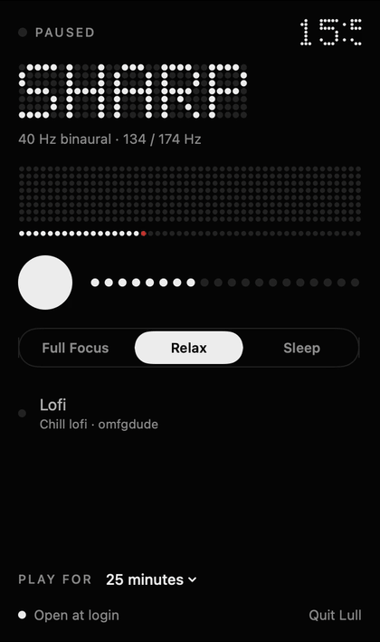

# Lull

A focus, relax and sleep sound player for the macOS menu bar, drawn as a dot-matrix display.

<p align="center"></p>

Lull plays seamless loops from the menu bar. The panel shows what is playing in a 5×7 dot font,
the sound's live spectrum as columns of dots, and the current round as a row of dots, with a single
red dot marking the present moment. The visual design is inspired by Nothing's dot-matrix style.
Lull is an independent project and is not affiliated with Nothing Technology Limited.

## Features

- **Five built-in mixes** in three groups:

  | Group | Mix | Sound |
  |---|---|---|
  | Full Focus | Sharp | 40 Hz binaural beat: 134 Hz left, 174 Hz right (use headphones) |
  | Full Focus | Brown Noise | Deep, even noise |
  | Relax | Lofi | "Chill lofi inspired" by omfgdude |
  | Sleep | Rain | A steady downpour |
  | Sleep | Pink Noise | Soft, even noise |

- **Gapless loops.** Every loop is cut and checked so that the point where it repeats cannot be heard.
- **Timers.** Play until stopped, for 25, 45 or 90 minutes, or in Pomodoro rounds (25/5 or 50/10)
  with a chime at each change.
- **Media keys.** The keyboard's play/pause key, AirPods and Control Center control Lull while it is the
  active player.
- **Widget** for the desktop and Notification Center.
- **URL scheme** for Shortcuts and Raycast: `lull://toggle`, `lull://play`, `lull://stop`,
  `lull://mix/<id>` (ids: `sharp`, `brown`, `lofi`, `rain`, `pink`).
- **Right-click** the menu bar icon to play or pause without opening the panel.

## Install

Requires macOS 14 (Sonoma) or later, on Apple silicon or Intel.

1. Download `Lull.zip` from the [latest release](../../releases/latest) and unzip it.
2. Move `Lull.app` to your Applications folder.
3. Open it. Lull is not signed with an Apple Developer ID, so macOS blocks the first launch:
   - **macOS 15 (Sequoia) and later:** open System Settings → Privacy & Security, scroll to the
     message about Lull, and click **Open Anyway**.
   - **macOS 14 (Sonoma):** right-click `Lull.app` in Finder and choose **Open**.
   - **Or, in Terminal:** `xattr -dr com.apple.quarantine /Applications/Lull.app`

Lull appears in the menu bar, not the Dock. To start it with your Mac, turn on *Open at login* in its panel.

## Build from source

Requirements: the Xcode Command Line Tools (`xcode-select --install`), `ffmpeg`, and Python 3 with NumPy.
Xcode itself is not needed.

```sh
python3 -m pip install numpy        # once
python3 tools/make_loops.py         # build the loops into audio/loops/ (generated or from audio/src/)
sh build.sh                         # build, install to ~/Applications and launch
sh build.sh check                   # build, run the self-test and render panel snapshots into build/
sh build.sh release                 # universal build zipped to build/Lull.zip
```

## Add your own mixes

Local builds can include mixes made from your own audio, kept in a `personal/` folder that git ignores:

- `personal/tracks.py` defines `PERSONAL_TRACKS` (and `PERSONAL_YT` for downloaded sources) in the
  same format as `TRACKS` in `tools/make_loops.py`.
- `personal/Personal.swift` defines `Mix.personal`, the extra rows in the panel, in the same format as
  `Mix.builtin` in `Sources/Model.swift`, plus an empty `personalLines` dictionary (`[:]`) if you have
  no spectrum previews.

When `personal/Personal.swift` exists, `sh build.sh` uses it in place of `Sources/Personal.swift`.
`sh build.sh release` always leaves it out.

## Credits and license

- Code: [MIT](LICENSE).
- Audio: Lofi and Rain are CC0 recordings from OpenGameArt; Sharp, Brown Noise and Pink Noise are
  generated by `tools/make_loops.py`. See [audio/src/CREDITS.md](audio/src/CREDITS.md).
